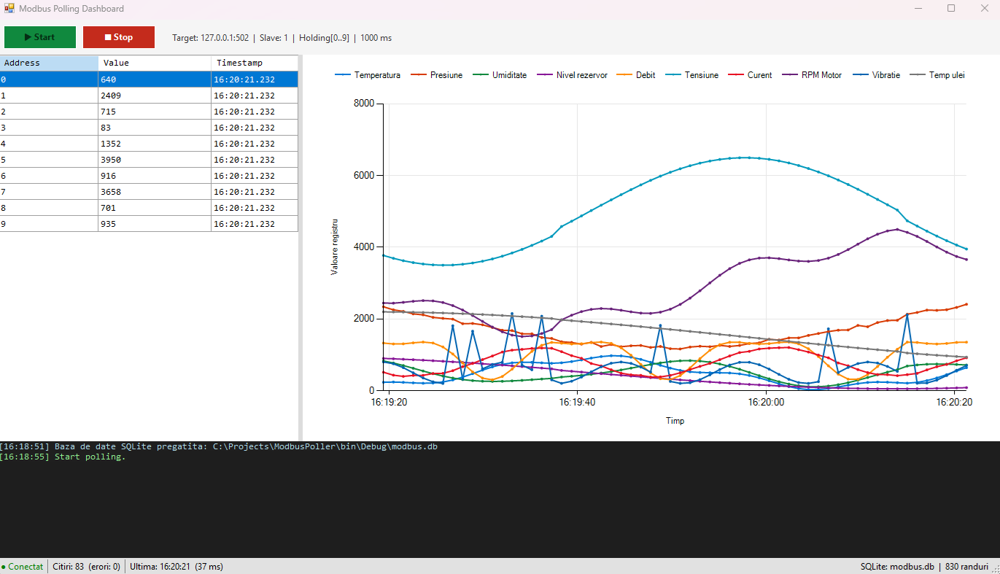

# ModbusPoller

Aplicatie Windows Forms (.NET Framework 4.8) care face polling periodic pe un dispozitiv Modbus TCP/RTU (PLC, senzor, simulator) si scrie valorile citite intr-o baza de date SQLite. Afiseaza datele in timp real intr-un dashboard cu tabel si grafic.



## Video demo

[](https://youtu.be/gF7N_3DXplo)

## Cuprins

1. Descriere generala
2. Caracteristici
3. Arhitectura
4. Schema logica
5. Fluxul de date
6. Tehnologii folosite
7. Cerinte de sistem
8. Baza de date
9. Configurare Modbus Slave
10. Script Python de simulare senzori

## 1. Descriere generala

**ModbusPoller** este un demo functional care arata cum se construieste un serviciu de achizitie date industriale folosind:

- **Modbus TCP/RTU** - protocolul standard industrial pentru comunicatia cu PLC-uri, senzori si alte echipamente
- **WinForms** - interfata grafica desktop, cu tabel si grafic in timp real
- **NModbus** - biblioteca open-source pentru comunicatia Modbus
- **Dapper + SQLite** - persistenta rapida a datelor fara EF Core

Aplicatia citeste la fiecare secunda un set de registre Modbus (Holding sau Input), afiseaza valorile in timp real si le scrie intr-o baza de date SQLite pentru analiza ulterioara.

## 2. Caracteristici

- Modbus TCP (port 502) si RTU (serial)
- Holding Registers (FC03) si Input Registers (FC04)
- Polling interval configurabil (1000 ms implicit)
- Dashboard cu tabel live + grafic in timp real (10 serii colorate)
- Alias-uri configurabile (ex: "Temperatura" in loc de "Reg 0")
- Persistenta SQLite prin Dapper (INSERT-uri rapide)
- Log de evenimente colorat
- Status bar cu indicator conexiune, contor citiri, timp raspuns
- Rulare ca aplicatie desktop sau Windows Service
- Configurare prin App.config (fara recompilare)

## 3. Arhitectura

Diagrama de ansamblu (in format text):

    +-------------------+        +-----------------------+        +------------------+
    |                   |        |                       |        |                  |
    |  Modbus Slave /   |  TCP   |   ModbusPoller        | SQLite |   modbus.db      |
    |  PLC / Senzor     |<------>|   (WinForms +         |<------>|   (ModbusLog)    |
    |                   |  502   |    Polling Loop)      | Dapper |                  |
    |  Holding Regs     |        |                       |        |                  |
    |  0..9 = valori    |        |   - NModbus           |        |   - Timestamp    |
    |                   |        |   - BackgroundService |        |   - DeviceId     |
    +-------------------+        +-----------------------+        |   - RegisterAddr |
                                           |                      |   - Value        |
                                           |                      +------------------+
                                           v
                                 +---------------------+
                                 |   Dashboard UI      |
                                 |   - DataGridView    |
                                 |   - Chart (live)    |
                                 |   - Log             |
                                 |   - Status bar      |
                                 +---------------------+

Componente principale:

| Componenta | Rol |
|-----------|-----|
| ModbusReader | Comunicatie Modbus TCP/RTU prin NModbus |
| PollingService | Bucla asincrona de citire periodica |
| DataRepository | INSERT-uri SQLite prin Dapper |
| DatabaseInitializer | Creaza tabela si indecsii la prima rulare |
| MainForm | UI-ul: grid, chart, log, status bar |
| RegisterSample | Model: Timestamp, Address, Value |

## 4. Schema logica

Diagrama detaliata a componentelor:

+---------------------------------------------------------------------+
|                          MODBUS POLLER                              |
|                     (WinForms .NET Framework 4.8)                   |
|                                                                     |
|  +-------------------------------------------------------------+    |
|  |                     Prezentare (UI)                         |    |
|  |  +----------+  +----------+  +----------+  +-------------+  |    |
|  |  | Toolbar  |  |   Grid   |  |  Chart   |  |    Log      |  |    |
|  |  | Start/   |  | Address  |  | 10 serii |  |  RichText   |  |    |
|  |  | Stop     |  | Value    |  | live     |  |  colorat    |  |    |
|  |  |          |  | Timestamp|  |          |  |             |  |    |
|  |  +----------+  +----------+  +----------+  +-------------+  |    |
|  +-------------------------------------------------------------+    |
|                              ^                                      |
|                              | BeginInvoke (thread-safe)            |
|                              |                                      |
|  +---------------------------+---------------------------------+    |
|  |                    Logica (Business)                        |    |
|  |  +----------------+    +--------------------------------+   |    |
|  |  |  PollingLoop   |    |        UpdateUi                |   |    |
|  |  |  (async task)  |--->|  - actualizeaza grid           |   |    |
|  |  |  - la 1000ms   |    |  - adauga puncte in chart      |   |    |
|  |  |  - citire modbus    |  - updateaza status bar        |   |    |
|  |  |  - scriere DB  |    |                                |   |    |
|  |  +-------+--------+    +--------------------------------+   |    |
|  +----------+--------------------------------------------------+    |
|             |                                                       |
|  +----------v-----------------------------------------------+        |
|  |                    Acces date (Data)                     |        |
|  |  +----------------+    +--------------------------------+|        |
|  |  | ModbusReader   |    |      DataRepository            |        |
|  |  | (NModbus 3.x)  |    |      (Dapper)                  |        |
|  |  |                |    |                                |        |
|  |  | TCP: 502       |    |  INSERT INTO ModbusLog         |        |
|  |  | RTU: COMx      |    |  PRAGMA WAL + NORMAL           |        |
|  |  +-------+--------+    +---------------+-----------------+        |
|  +----------+-----------------------------+-----------------+        |
+-------------+-----------------------------+-------------------------+
              |                             |
              | Modbus TCP                  | SQL
              | (Function Code 03/04)       |
              v                             v
   +----------------------+      +------------------------+
   |   Modbus Slave       |      |   SQLite               |
   |   (simulator/PLC)    |      |   modbus.db            |
   |                      |      |                        |
   |   Holding Reg 0..9   |      |   Table: ModbusLog     |
   |   Values: 0..65535   |      |   Id, Timestamp,       |
   |                      |      |   DeviceId, Address,   |
   |                      |      |   Value                |
   +----------------------+      +------------------------+


Parametri Modbus folositi:

| Parametru | Valoare demo | Descriere |
|-----------|--------------|-----------|
| Protocol | Modbus TCP | Alternativ: Modbus RTU (serial) |
| Port | 502 | Portul standard Modbus TCP |
| Slave ID | 1 | Identificatorul dispozitivului |
| Function Code | 03 | Read Holding Registers |
| Start Address | 0 | Prima adresa citita |
| Quantity | 10 | Numarul de registre |
| Polling interval | 1000 ms | Frecventa de citire |
| TCP timeout | 2000 ms | Timeout citire/scriere |

## 5. Fluxul de date

Initializare (o singura data, la pornire):

    Main() [Program.cs]
       |
       +--> SQLitePCL.Batteries_V2.Init()       <- initializeaza provider SQLite
       |
       +--> Application.Run(new MainForm())
       |
       +--> MainForm.OnLoad()
            |
            +--> DatabaseInitializer.EnsureDatabase()
                 |
                 +--> creeaza modbus.db daca nu exista
                 +--> creeaza tabela ModbusLog daca nu exista
                 +--> creeaza indecsii

Bucla de polling (la fiecare secunda):

    User apasa [Start]
       |
       +--> MainForm.StartPolling()
            |
            +--> Task.Run(PollingLoop)
                 |
                 +--> while (!cancelled)
                      |
                      +--> [1] ModbusReader.ReadHoldingRegisters(0, 10)
                      |        |
                      |        +--> TCP connect -> FC03 -> primeste 10 ushort
                      |
                      +--> [2] Construieste List<RegisterSample>
                      |
                      +--> [3] DataRepository.Insert() x 10
                      |        |
                      |        +--> SQLite INSERT (cu Dapper)
                      |
                      +--> [4] BeginInvoke(UpdateUi)
                      |        |
                      |        +--> actualizeaza DataGridView
                      |        +--> adauga 10 puncte in Chart
                      |        +--> updateaza StatusStrip
                      |
                      +--> [5] await Task.Delay(1000)

Oprire:

    User apasa [Stop]
       |
       +--> MainForm.StopPolling()
            |
            +--> _cts.Cancel()
                 |
                 +--> Task.Delay() arunca TaskCanceledException
                      |
                      +--> while (!cancelled) iese -> thread se termina

## 6. Tehnologii folosite

| Componenta | Tehnologie | Versiune |
|-----------|-----------|----------|
| Framework | .NET Framework | 4.8 |
| UI | Windows Forms | (inclus) |
| Grafic | System.Windows.Forms.DataVisualization | (inclus) |
| Comunicatie Modbus | NModbus | 3.0.81 |
| Extensie RTU | NModbus.Serial | 3.0.83 |
| ORM | Dapper | 2.1.35 |
| Baza de date | SQLite | 3.x (via winsqlite3.dll) |
| Driver SQLite | Microsoft.Data.Sqlite.Core | 8.0.0 |
| Provider nativ | SQLitePCLRaw.bundle_winsqlite3 | 2.1.11 |

## 7. Cerinte de sistem

Pentru rulare:
- Windows 10 sau 11
- .NET Framework 4.8
- 2 GB RAM minim
- 50 MB spatiu liber

Pentru dezvoltare:
- Visual Studio 2019 sau 2022 (Community)
- Workload: .NET desktop development

Pentru testare:
- Modbus Slave (simulator) - modbustools.com/modbus_slave.html
- Python 3.8+ (pentru scriptul de simulare senzori)
- DB Browser for SQLite (pentru inspectarea datelor)

## 8. Baza de date

### Tehnologia folosita

**SQLite** - baza de date embedded, serverless, stocata intr-un singur fisier local (`modbus.db`).

### Tabele folosite

Baza de date `modbus.db` contine o singura tabela principala, plus indecsii asociati.

| Tabela | Tip | Rol | Randuri estimate |
|--------|-----|-----|------------------|
| `ModbusLog` | Tabela principala | Stocheaza fiecare citire Modbus (un rand per registru per ciclu) | ~864.000/zi la 10 registre × 1 sec |
| `sqlite_sequence` | Tabela interna SQLite | Gestioneaza AUTOINCREMENT pentru `ModbusLog.Id` | 1 |
| `sqlite_stat1` | Tabela interna SQLite | Statistici pentru optimizatorul de query-uri | 0-5 |

**Nota:** Tabelele `sqlite_*` sunt create automat de SQLite si nu trebuie modificate manual. Sunt incluse aici doar pentru completitudine.

### Structura tabelei `ModbusLog`

| Coloana | Tip SQLite | Null | Default | Descriere | Exemplu |
|---------|-----------|------|---------|-----------|---------|
| `Id` | INTEGER | NOT NULL | AUTOINCREMENT | Cheie primara, generata automat | `1`, `2`, `3`, ... |
| `Timestamp` | TEXT | NOT NULL | - | Momentul citirii, format ISO 8601 UTC | `2025-10-12T14:23:45.1234567Z` |
| `DeviceId` | TEXT | NOT NULL | - | Identificatorul dispozitivului | `PLC-01` |
| `RegisterAddress` | INTEGER | NOT NULL | - | Adresa registrului Modbus | `0` .. `65535` |
| `Value` | INTEGER | NOT NULL | - | Valoarea citita (unsigned 16-bit) | `0` .. `65535` |

**Cheie primara:** `Id` (INTEGER PRIMARY KEY AUTOINCREMENT)

### Schema SQL completa

```sql
-- Tabela principala: fiecare citire Modbus = un rand
CREATE TABLE IF NOT EXISTS ModbusLog (
    Id              INTEGER PRIMARY KEY AUTOINCREMENT,
    Timestamp       TEXT    NOT NULL,
    DeviceId        TEXT    NOT NULL,
    RegisterAddress INTEGER NOT NULL,
    Value           INTEGER NOT NULL
);

-- Index pe Timestamp (pentru query-uri de tip "ultimele N")
CREATE INDEX IF NOT EXISTS IX_ModbusLog_Timestamp
    ON ModbusLog(Timestamp DESC);

-- Index compus (pentru query-uri "toate valorile registrului X")
CREATE INDEX IF NOT EXISTS IX_ModbusLog_Device_Reg
    ON ModbusLog(DeviceId, RegisterAddress);

## 9. Configurare Modbus Slave

Modbus Slave este un simulator care expune registre Modbus pe care aplicatia le citeste. Il folosim pentru a simula un PLC sau un senzor industrial real.

Descarcare: [modbustools.com/modbus_slave.html](https://www.modbustools.com/modbus_slave.html)

### Pasul 1: Pornire si conexiune

1. Deschide aplicatia **Modbus Slave**
2. Mergi la meniul **Connection ? Connect...** (sau apasa `F3`)
3. In dialogul **Connection Setup** completeaza:

| Camp | Valoare | Descriere |
|------|---------|-----------|
| Connection | `Modbus TCP/IP` | Protocolul de comunicatie |
| IP Address | `127.0.0.1` | Localhost (aplicatia ruleaza pe acelasi PC) |
| Port | `502` | Portul standard Modbus TCP |
| IPv4 | ? bifat | Folosim IPv4 |

4. Apasa **OK**

Daca portul 502 este deja ocupat de alt proces, primesti eroare. In acest caz, schimba in `5020` atat in Modbus Slave cat si in `App.config` (`Modbus.Port`).

### Pasul 2: Definirea registrelor

1. Mergi la meniul **Setup ? Slave Definition...** (sau apasa `F8`)
2. In dialogul **Slave Definition** completeaza:

| Camp | Valoare | Descriere |
|------|---------|-----------|
| Slave ID | `1` | Identificatorul dispozitivului (1..247) |
| Function | `03 Holding Register (4x)` | Function code 03 - citire holding registers |
| Address | `0` | Prima adresa citita |
| Quantity | `10` | Numarul de registre expuse |

3. Apasa **OK**

Vei vedea o fereastra cu 10 randuri (registrele 0..9).

### Pasul 3: Popularea valorilor

Fa dublu-click pe fiecare celula din coloana `00000` si introdu valorile demo. Acestea simuleaza senzori industriali reali:

| Addr | Name (alias) | Valoare demo | Interpretare | Unitate |
|------|--------------|--------------|--------------|---------|
| 0 | Temperatura | `235` | 23.5 °C | °C × 10 |
| 1 | Presiune | `1013` | 1013 mbar | mbar |
| 2 | Umiditate | `48` | 48 % | % |
| 3 | Nivel rezervor | `750` | 750 mm | mm |
| 4 | Debit | `125` | 12.5 L/min | L/min × 10 |
| 5 | Tensiune | `230` | 230 V | V |
| 6 | Curent | `45` | 4.5 A | A × 10 |
| 7 | RPM Motor | `1450` | 1450 rpm | rpm |
| 8 | Vibratie | `12` | 1.2 mm/s | mm/s × 10 |
| 9 | Temp ulei | `678` | 67.8 °C | °C × 10 |

**Sfat pentru populare rapida:** dupa ce introduci prima valoare si apesi `OK`, cursorul ramane pe celula. Apasa `?` (sageata jos) pentru a trece la urmatoarea, apoi `Enter` pentru a o edita. Astfel completezi toate 10 registre in mai putin de 30 de secunde.

**Conventie de scalare:** Registrele Modbus stocheaza doar numere intregi (unsigned 16-bit, 0..65535). Pentru valori zecimale (temperatura 23.5 °C), se foloseste o conventie de scalare: valoarea din registru se imparte la 10. Aceasta este o practica standard in industrie.

### Pasul 4: Verificare conexiune

Statusul din bara de titlu a Modbus Slave va arata `No connection` pana cand pornesti aplicatia ModbusPoller.

Dupa ce rulezi aplicatia (`F5` in Visual Studio):

| Indicator | Valoare | Semnificatie |
|-----------|---------|--------------|
| Status | `Connected` (verde) | Aplicatia s-a conectat cu succes |
| Rx | Creste cu 1/secunda | Numarul de cereri Modbus primite |
| Tabel | Valori actualizate | Registrele sunt citite corect |

Daca statusul ramane `No connection`:
- Verifica ca aplicatia C# ruleaza (butonul `Start` apasat)
- Verifica ca portul din `App.config` (`Modbus.Port`) corespunde cu cel din Modbus Slave
- Verifica ca nu ai firewall care blocheaza conexiunea pe localhost

### Optiuni avansate: Auto increment / Auto decrement

In dialogul de editare a unei valori (dublu-click pe celula), poti bifa:

| Optiune | Efect | Cand se foloseste |
|---------|-------|-------------------|
| Auto increment | Valoarea creste cu 1 la fiecare citire Modbus | Testare rampa liniara |
| Auto decrement | Valoarea scade cu 1 la fiecare citire Modbus | Testare rampa descendenta |

**Atentie:** aceste optiuni fac graficul sa arate ca o linie dreapta (creste/scade constant). Pentru un demo spectaculos, **NU le folosi** - foloseste in schimb scriptul Python de simulare senzori (vezi sec?iunea urmatoare).

### Capturi de ecran


### Rezumat configurare

| Parametru | Valoare | Unde se seteaza |
|-----------|---------|-----------------|
| Protocol | Modbus TCP/IP | Modbus Slave ? Connection |
| IP | 127.0.0.1 | Modbus Slave ? Connection |
| Port | 502 | Modbus Slave ? Connection + App.config |
| Slave ID | 1 | Modbus Slave ? Slave Definition + App.config |
| Function | 03 (Holding) | Modbus Slave ? Slave Definition |
| Start Address | 0 | Modbus Slave ? Slave Definition + App.config |
| Quantity | 10 | Modbus Slave ? Slave Definition + App.config |
| Valori | 235, 1013, 48, 750, 125, 230, 45, 1450, 12, 678 | Modbus Slave ? tabel |

Toate valorile din tabelul de mai sus trebuie sa corespunda cu cele din `App.config` pentru ca aplicatia sa citeasca corect.

## 10. Script Python de simulare senzori

Modbus Slave singur afiseaza valori statice (liniile din grafic sunt drepte). Pentru un demo spectaculos, cu valori care variaza natural ca niste senzori industriali reali, folosim un script Python care scrie automat in registrele Modbus Slave.

Scriptul se afla in `scripts/simulate_sensors.py` si face parte din repository.

### Ce face scriptul

Simuleaza 10 senzori industriali folosind o combinatie de:

| Tehnica | Efect | Exemple de registre |
|---------|-------|---------------------|
| Sinusoide cu perioade diferite | Variatii line, periodice | Temperatura, Presiune |
| Random walk (mers aleator) | Aspect natural, ca un senzor real | Umiditate, Debit |
| Zgomot gaussian | Micro-fluctuatii (zgomot de masura) | Toate registrele |
| Spike-uri ocazionale | Socuri, evenimente rare | Vibratie, Curent |

Rezultatul: graficul din dashboard arata ca un SCADA industrial real, cu curbe care urca si coboara natural, se intersecteaza, si au ocazional varfuri.

### Cerinte

| Componenta | Versiune minima | Observatii |
|------------|-----------------|------------|
| Python | 3.8+ | Instalat din [python.org](https://www.python.org/downloads/) |
| pymodbus | 3.6.8 | **Exact** aceasta versiune - vezi nota mai jos |

**Nota importanta despre versiunea pymodbus:**
- Versiunea **3.6.8** este ultima cu API-ul stabil (`ModbusSequentialDataBlock` disponibil in `pymodbus.datastore`)
- Versiunile **3.13+** au schimbat API-ul: `ModbusSequentialDataBlock` a fost inlocuit cu `SimData` / `SimDevice`
- Scriptul nu functioneaza cu pymodbus 3.13 sau mai nou fara modificari

### Instalare Python

1. Descarca Python 3.8+ de la [python.org/downloads](https://www.python.org/downloads/)
2. **IMPORTANT:** La instalare, bifeaza **"Add Python to PATH"**
3. Deschide PowerShell si verifica:

```powershell
py --version

